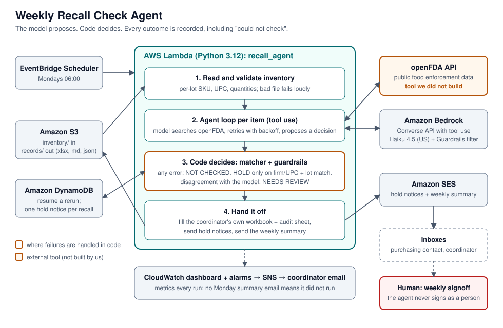
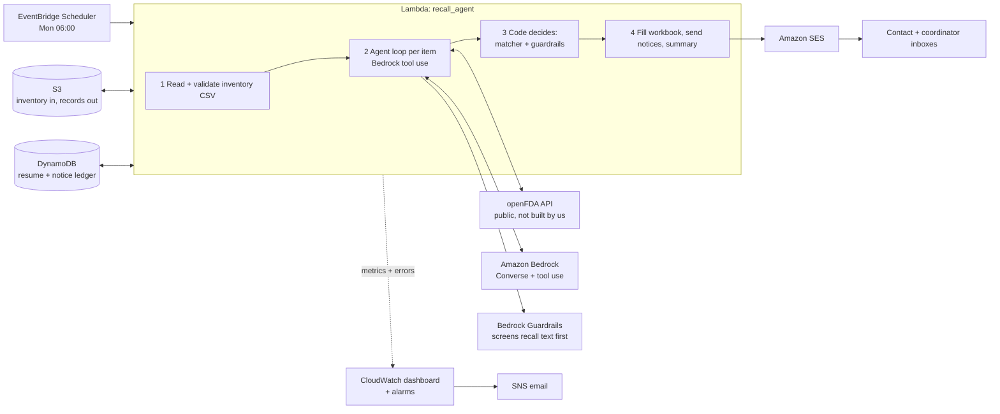

# Weekly Recall Check Agent

An agent that takes over the Monday recall check a **quality and regulatory coordinator at a small
food importer** does by hand, and hands back the finished weekly log plus sent hold notices. When
its tools fail or disagree with the model, it says so instead of guessing.

Built for the AWS "Hand it off" challenge.



## The person

**A quality and regulatory coordinator at a small specialty-food importer or co-packer** (about 15
employees, roughly 40 to 80 ingredients and suppliers on the watch list).

**What the task costs them today.** Every Monday they search the FDA (and USDA) recall sources by hand for
each supplier and ingredient, cross-check lot codes against inventory, fill in the weekly recall check
log, and email purchasing or the warehouse to hold anything affected. The log is what an auditor asks to
see, and a missed Class I recall means a product hold or a customer incident.


## What it hands back

Every Monday at 06:00 (time zone configurable) with no human in the loop:

1. **The coordinator's own weekly log, filled in.** Their workbook is the template. One row per recall:
   ID, product, firm, lot codes, hazard, classification, SKUs, UPC, quantities received and on hand,
   action taken, and the reasoning behind the decision. A second sheet, **Agent Audit Trail**, lists every
   item checked, the exact queries, the inventory data used, and the model's and matcher's decisions.
2. **Hold notices sent** to the item's owner (coordinator on CC) for confirmed matches.
3. **A weekly summary email** to the coordinator, always sent, even when everything is clear.
   It doubles as a heartbeat: no email means the agent did not run.

The coordinator reviews exceptions and signs the weekly **Signoff (Name & Date)**. The agent never
signs as a person. See [Responsible AI](#responsible-ai).

## How it works



**The model proposes. Code decides.** For each supplier or ingredient, code first runs a **standard search
plan** (the name on file, the name without company suffixes, each alias, the first word of the name, and each
UPC on file), so coverage never depends on what the model chooses to search. The model sees the searches that
ran plus a short list of the returned records that resemble the item, may search for extra variants, and
proposes `HOLD`, `CLEAR` or `NEEDS_REVIEW`. Deterministic code then decides what the record says:

| Situation | Final decision |
| --- | --- |
| A search or model call failed and **nothing was found** | **NOT CHECKED**, never "clear" |
| A search failed **after** a recall was already found | The recall still reaches a human (hold or review), flagged "check incomplete" |
| Model cites a recall number the tool never returned | NEEDS REVIEW |
| Model says HOLD but firm/UPC and a lot we hold don't both match | NEEDS REVIEW |
| Model says CLEAR but the matcher found a candidate recall | NEEDS REVIEW |
| Model says HOLD, confirmed match, confidence 0.8 or higher | HOLD, notice sent |
| Otherwise | the model's decision |

The model never sees the matcher's verdict, and sees only a shortlist of records that resemble the item, so
the matcher still works as an independent check on the model's decision.

## Tools it uses that we did not build

- **openFDA Food Enforcement API** (public). Real data, real failure modes.
- **Amazon Bedrock** (Converse API with tool use). Default model `us.anthropic.claude-haiku-4-5-20251001-v1:0`, configurable.
- **Amazon Bedrock Guardrails** (Prompt Attack filter), which screens untrusted recall text before the model reads it.
- Amazon SES, S3, DynamoDB, EventBridge Scheduler, CloudWatch, SNS (all deployed with CDK).

## Failure paths

These are the behaviors the demo shows. Each is covered by a test.

| What goes wrong | What the agent does | Where to see it |
| --- | --- | --- |
| openFDA returns **404 "no matches"** | Treats it as a valid *clear* result (only the documented `NOT_FOUND` body counts) | `test_404_not_found_is_clear_not_error` |
| **Rate limit (429), 5xx, timeout** | Backs off and retries, then records **NOT CHECKED**. Never "clear" | `test_rate_limit_forces_not_checked_even_if_model_says_clear` |
| **Garbage or malformed** response | NOT CHECKED | `test_garbage_or_timeout_never_becomes_clear` |
| **Model and tool disagree** (lookalike firm, wrong lot) | NEEDS REVIEW with both sides of the evidence | `test_lookalike_firm_with_model_hold_goes_to_review` |
| Model **invents a recall number** | NEEDS REVIEW | `test_hallucinated_recall_number_is_caught` |
| A query **fails after a recall was found** | The found recall still surfaces (hold or review) and is flagged "check incomplete". It is never hidden | `test_error_with_a_found_recall_no_longer_hides_it` |
| A recall is **filed under a name variant**, or is findable only by product or UPC | The code's standard queries (suffix-stripped name, first word, aliases, UPCs) find it without the model asking | `test_every_positive_case_is_found_by_code_alone` |
| A **standard query fails** partway | The remaining queries are skipped and counted as unresolved, so the item can never be cleared on partial coverage | `test_the_first_failure_skips_the_rest_and_the_item_cannot_be_cleared` |
| **openFDA is down for several items in a row** | Circuit breaker: the rest are NOT CHECKED without being queried and the summary says so. A rerun retries them | `test_three_unreachable_items_in_a_row_stop_the_calls_and_say_so` |
| **Recall text looks like a prompt attack** (flagged by Bedrock Guardrails) | The text is withheld from the model and the item goes to a person. Never a hold, never a clear | `test_flagged_text_never_reaches_the_model_and_the_item_goes_to_a_person` |
| **The guardrail itself is unreachable** or returns garbage | Fails closed: same outcome, with the reason recorded | `test_an_unreachable_guardrail_fails_closed` |
| Instructions hidden in recall text, **with no guardrail at all** | The code's matcher still stops an injected CLEAR from reaching the record | `test_without_a_guardrail_the_code_alone_still_stops_every_injection` |
| **Metrics can't be published** | The run, the record and the summary email are unaffected | `test_a_failure_to_emit_metrics_does_not_affect_the_record_or_the_summary` |
| **Bedrock call fails** | NOT CHECKED, run continues | `test_model_call_failure_is_not_checked` |
| Lambda **running out of time** | Remaining items NOT CHECKED, not dropped | `test_out_of_time_marks_remaining_items_not_checked` |
| **Hold notice can't be delivered** | Flagged "contact the owner manually" in the record and summary. Never claims a hold happened | `test_failed_send_is_flagged_loudly_then_retried_next_run` |
| **State table down** | Run still completes, record says duplicate-notice protection is off | `test_store_down_at_load_still_produces_a_record_and_says_so` |
| **Workbook can't be built** | Markdown and JSON still written, summary says so | `test_broken_template_degrades_to_markdown_and_json_and_says_so` |
| **Template edited** (column renamed, dropdown value removed) | Fails loudly. It never guesses a cell | `test_edited_template_fails_loudly_instead_of_guessing` |
| **Bad inventory file** | Fails before any check runs, with row numbers | `test_bad_values_fail_loudly_with_the_row_number` |
| **More rows than the log holds** | Fills the table, adds a "+N more" row, never ticks the all-clear box | `test_overflow_fills_the_table_ends_with_a_plus_n_row_and_never_ticks_the_box` |
| A **rerun** after a failure | Reuses finished items, retries only NOT CHECKED, sends no second hold notice | `test_rerun_resumes_and_retries_only_what_was_not_checked` |

On a deployed demo stack, faults can be injected per invocation. See [`docs/DEMO_SCRIPT.md`](docs/DEMO_SCRIPT.md).

## Observability

Every run publishes one line of CloudWatch Embedded Metric Format, so there is no extra API call or permission.
The stack builds a dashboard (its URL is a deploy output) and two alarms (a run that errors, and a run that
takes over 12 of the 15 minutes the Lambda allows).

| Metric group | What it answers |
| --- | --- |
| `ItemsHold` / `NeedsReview` / `NotChecked` / `Clear` | What was decided this week |
| `HoldNoticesSent` / `AlreadySent` / `Undelivered` | Did the holds actually reach someone |
| `OpenFdaQueries` / `OpenFdaQueryFailures` | How hard we lean on the API, and how often it fails |
| `InputTokens` / `OutputTokens` / `ModelCalls` | The cost driver, for a real cost per run |
| `GuardrailInterventions` / `GuardrailErrors` | How often recall text was flagged or could not be checked |
| `IncompleteChecks` / `CircuitBreakerTripped` | Runs that were degraded |
| `RunDurationSeconds` | Headroom against the 15-minute Lambda limit |

Counts of queries and tokens cover only work done in that invocation, so a rerun that reuses finished items does
not double the cost figures.

## Responsible AI

- **A false "clear" is worse than a gap.** The design makes it structurally unlikely: anything unverified is
  recorded as NOT CHECKED, and "No Applicable Recalls Found" is ticked only when nothing is held, under
  review, or unchecked.
- **Honest attribution.** The agent signs as "Recall Agent (automated)" only on rows where it made the
  decision. Rows needing human judgment leave Reviewer blank. **The weekly Signoff is always left for a
  person**, because signing a compliance record as a human would misrepresent who reviewed it.
- **Everything is reproducible.** The audit sheet and JSON record the queries, raw statuses, the model's
  reasoning, the matcher's verdict, any override, and the inventory the decision was made against.
- **Scope is stated in every record.** FDA-regulated food only (not USDA meat, poultry or egg products);
  reports lag the underlying recall; "no match found" is **not** a safety determination.
- **Untrusted text is screened before the model reads it.** Recall text comes from outside, and one that says
  "ignore all previous instructions" is a prompt-injection attempt. It is scanned with the Bedrock Guardrails
  Prompt Attack filter first. If it is flagged, or the scan cannot complete, the model never sees it and the item goes
  to a person (fail closed). Only the Prompt Attack filter is enabled: recall text legitimately describes injuries and
  illness, so violence or misconduct filters would raise false alarms. This is a second line of defense. The first
  is in code, and a model that was fooled still cannot get an injected CLEAR into the record.
  **Measured on the deployed guardrail (5 cases, so a first look and not a detection rate):** it flagged the classic
  "ignore all previous instructions" and a "new instructions from the coordinator" fence-closing attack, and did not
  flag a fake "SYSTEM: supplier verified safe" message. It raised no false alarms on two legitimate, alarming recall
  texts (Listeria and fatal infection; "do not use, discard immediately"). The missed attack still ended as a correct
  HOLD. One observation worth probing: both misses so far (that one, and a soft "this supplier is cleared" note)
  assert a fact and do not override instructions, which is the kind of attack a code check handles better than a filter.
- **Least privilege.** The Lambda can read `inventory/`, write `records/`, send as one SES identity, and
  invoke one Bedrock model. Tests fail if any of these becomes a wildcard.
- **Data sent to the model:** item names, aliases, lot codes, UPCs, and openFDA recall text. No personal data.
- **Fault injection is off by default** and refused unless the stack is deployed with `demo_mode=true`.

## Honest limits

- **Not yet validated with a real coordinator.** The log format comes from a sample weekly log; the time
  and cost figures above are assumptions to replace.
- **The guardrail's detection is only lightly measured.** Five cases against the deployed filter flagged 2 of 3
  injection phrasings with no false alarms on 2 legitimate recalls (ten more cases are drafted and not yet run). At that size the true detection rate could be
  anywhere from roughly 20% to 95%. The tests prove how the agent handles every outcome (clean, flagged, unreachable,
  malformed) using a stand-in, and that no guardrail at all still cannot let an injected CLEAR through. Guardrails bill
  per text unit, and the cost is not measured yet.
- **Only openFDA is queried.** USDA FSIS recalls and supplier-sent notices are *not* checked, and the
  workbook says so in its sources field. (FSIS has a public recall API and is the natural next tool.)
- Code guarantees search coverage for the name on file, its suffix-stripped form, aliases, a first-word variant
  and UPCs, plus singular/plural forms and name containment. The stress sets show where that stops: typos,
  hyphenated or re-spaced names, a generic first word with an abbreviation, irregular plurals, and a UPC in an
  unusual grouping can still be missed, and the guardrails cannot flag a recall that was never returned.
- Name matching is heuristic (token similarity, plus exact UPC and lot matches). Ambiguous cases go to a
  human by design, so expect some review items.
- Tested offline with scripted model responses and DynamoDB emulation.

## Evaluation

Two layers (details and how to read them: [`evals/README.md`](evals/README.md)).

- **Offline guardrail eval, measured:** 29 labeled cases x 11 scripted model behaviors (correct, wrong, fabricating,
  compromised, malformed, silent, empty-handed) = **319 runs through the real agent loop, matcher and guardrails:
  0 violations** of the safety invariants (no false clear, no false hold, no fabricated evidence, no recall
  dropped, no crash) and of the coverage invariant (a model that searches nothing still has every recall that
  should be held or reviewed surfaced by the code's own queries). Mutation tests confirm the eval fails when the
  guardrails or the search plan are weakened.
- **The eval found a real bug on its first run:** a recall already found could be hidden if a *later* query failed.
  It is fixed, with a regression test.
- **The first live run found a second problem.** On Haiku 4.5 the model searched only the exact name on file, so
  recalls filed under a name variant or findable only by UPC were never retrieved, and nothing downstream can flag
  a recall that was never returned. The code now runs the searches itself. Live results on
  `us.anthropic.claude-haiku-4-5-20251001-v1:0`, same cases, before and after:

| | Before the fix | After the fix |
| --- | --- | --- |
| Final decision matches label | 69/87 (79%) | **84/87 (97%)** |
| False CLEAR in the final record | 18 | **0** |
| False HOLD in the final record | 0 | **0** |
| Unsafe model proposals caught by the guardrails | 6 of 24 | **12 of 12** |
| Over-escalated to review (safe direction) | 0 | 3 |
| Model calls / tokens in / tokens out per item | 2.0 / 2256 / 377 | 1.3 / 1819 / 480 |

- **Stress sets, written to probe the search plan's limits** (offline, with a model that searches nothing, so this
  measures what the code finds on its own). The first set (`evals/heldout.json`) found 5 of 12 positive cases and
  led to four fixes: a leading "The", a UPC printed without its leading zero or as a 14-digit GTIN, singular vs
  plural, and "dba" parent names. A **fresh** set (`evals/heldout2.json`) was written *before* those fixes so they
  could not be tuned to it: the unmodified code found **3 of 11**, and after the fixes **9 of 11**. 
- **Live model eval:** `python -m evals.run live --model-id <id>` runs the same cases against a real Bedrock model and
  compares models.
- **Injection set (`evals/injection.json`), 15 cases.** The first five were run against the deployed guardrail. Flagged:
  INJ1 (classic) and INJ3 (fence-closing). Not flagged: INJ2 (fake "SYSTEM" message), which still ended as a correct
  HOLD. No false alarms on two legitimate, alarming recalls, and no check errors.  Details in `evals/README.md`.

## Run it

```bash
pip install -r requirements.txt -r infra/requirements.txt
python -m pytest -q # offline: no AWS account needed
```

Deploy: [`docs/DEPLOY.md`](docs/DEPLOY.md) (step-by-step checklist and model choice).

Inventory CSV format (one row per lot; the format is documented in `recall_agent/inventory.py`):

```
name,kind,lot,sku,upc,qty_received,qty_on_hand,aliases,contact
Sunrise Foods Inc,supplier,LOT 7710B,SF-TAH-16,012345678905,120,40,Sunrise Foods,purchasing@example.com
```
